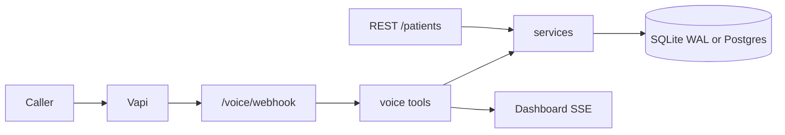

# Voice patient registration

**Phone number to call:** not provisioned yet. A Vapi account and a U.S. number are required. See [What I need from you](#what-i-need-from-you).

**API base URL:** not deployed yet. Local: `http://127.0.0.1:8000`

**Dashboard:** `http://127.0.0.1:8000/dashboard` (same path on the deployed host)

**Test notes:** No API key. The API is open on purpose. Do not put real patients in it. Seed records, once the app starts with `SEED_ON_STARTUP=true`:

| Name | DOB | Phone | Notes |
|---|---|---|---|
| Jane Doe | 03/15/1985 | 2025550101 | `jane.doe@example.com`, Washington, DC 20500. Fictional 555-01xx number. |
| Carlos Rivera | 11/02/1990 | 4155550199 | `carlos.rivera@example.com`, San Francisco, CA 94105. Preferred language Spanish. |

Webhook calls need `X-Vapi-Secret` (or `Authorization: Bearer`) matching `VAPI_WEBHOOK_SECRET`. In `APP_ENV=development` an empty secret is allowed. In `production` it is required.

---

A voice agent that is measurably reliable. A caller registers with a normal conversation. The same rules check every field whether it arrives by phone or by HTTP, and the record is still there after a restart.

## Architecture



Vapi owns the phone, speech-to-text, the live model, and text-to-speech. This service owns the rules, the draft, and the database.

- `app/voice/vapi_adapter.py` is the only file that knows Vapi's JSON. Payload shapes were checked against the Vapi server-event and custom-tool docs on 27 Oct 2026.
- `app/voice/tools.py` and `app/api/patients.py` both call `app/services/`. Routes do not contain field rules. Tools do not contain SQL.
- `app/services/validation.py` is the one validator. The database repeats the durable constraints (`CHECK` on sex, state, phone, ZIP, lengths).

More detail: [docs/ARCHITECTURE.md](docs/ARCHITECTURE.md). Trade-offs: [docs/DECISIONS.md](docs/DECISIONS.md).

## Tech stack

| Choice | Why |
|---|---|
| Vapi | One U.S. number plus STT, TTS, and tool webhooks. Building Twilio plus a separate STT/TTS stack does not fit a reliable three-hour core. All of that code sits behind `vapi_adapter.py`. |
| GPT-4o-mini inside Vapi | Tool calling with low latency. The live model is configured on the assistant (`VAPI_MODEL`), not hardcoded. |
| FastAPI + Pydantic v2 | Typed requests, `/docs`, and a small process that answers immediately. |
| SQLAlchemy 2 + SQLite WAL | One file on a persistent volume survives restarts and needs no extra database. Set `DATABASE_URL=postgresql+psycopg://...` and install `psycopg[binary]` to move to Postgres. Queries do not change. Checks use `length`, `substr`, and `IN`, which both databases accept. |
| Static dashboard | No build step. Server-Sent Events push field updates. |
| pytest | Validators, the five endpoints, and the voice tools. |

Run one Uvicorn worker with SQLite. More workers need Postgres.

## Setup

### Local

```bash
python -m venv .venv
.venv\Scripts\activate          # Windows
pip install -r requirements.txt
copy .env.example .env
uvicorn app.main:app --reload --port 8000
```

Open `http://127.0.0.1:8000/docs`, `http://127.0.0.1:8000/dashboard`, and `http://127.0.0.1:8000/health`.

For a real call while developing, expose port 8000 with ngrok and set `PUBLIC_BASE_URL` to the https origin. Point Vapi at `https://<ngrok>/voice/webhook`.

```bash
pytest
python -m evals.run --all
python scripts/smoke_test.py http://127.0.0.1:8000
```

### Deploy

Railway (`railway.toml`) or Render (`render.yaml`). Use a paid instance so the process does not sleep. Mount a volume at `/data` and set:

```
APP_ENV=production
DATABASE_URL=sqlite:////data/patients.db
SEED_ON_STARTUP=true
PUBLIC_BASE_URL=https://<your-host>
VAPI_WEBHOOK_SECRET=<long random string>
VAPI_MODEL=gpt-4o-mini
VAPI_VOICE_PROVIDER=vapi
VAPI_VOICE_ID=Elliot
```

`/health` is the health check. If a host still sleeps, hit `/health` every few minutes from an external cron. Do not use a free sleeping web dyno for the review call.

### Voice platform

Checked against [Vapi server events](https://docs.vapi.ai/server-url/events) and [custom tools](https://docs.vapi.ai/tools/custom-tools).

1. Create a Vapi account and buy one U.S. number. This costs money, so it is not done in the repo.
2. In Vapi, add an OpenAI key or enable Vapi's own model billing so `gpt-4o-mini` can run.
3. Set the phone number's server URL to `https://<host>/voice/webhook`.
4. Create a Bearer credential whose header name is `X-Vapi-Secret`, bearer prefix off, token equal to `VAPI_WEBHOOK_SECRET`. Attach it to that server URL. Saved resources get the header. A transient assistant pasted into an API call often does not.
5. Leave the phone number **without** an assistant id. Vapi then sends `assistant-request`. This server answers within a local database lookup (the platform limit is 7.5 seconds) with a transient assistant: the prompt from this repo, the tools below, voice `Elliot`, Deepgram `nova-2` with `language: multi`, and `silenceTimeoutSeconds: 30`.
6. Optional: save an assistant in the dashboard, set `VAPI_ASSISTANT_ID`, and put `{{caller_context}}` in its system prompt. The webhook then returns that id plus a per-call first message. The git prompt is no longer what runs unless you paste `app/voice/prompts/system_prompt.md` (comments removed) into the dashboard.

Tool calls arrive as `message.type = tool-calls` with `toolCallList[].function.name` and `arguments` (object or JSON string). Older payloads with `name` + `parameters` are accepted too. The response is always HTTP 200:

```json
{"results":[{"toolCallId":"abc","result":"{\"ok\":true,\"say\":\"Got it.\"}"}]}
```

`end-of-call-report` stores the transcript and summary and prints the final payload as one JSON line on stdout.

Tools the assistant is given: `lookup_caller`, `record_field`, `check_address`, `get_draft`, `reset_draft`, `set_proxy_registration`, `confirm_registration`, `save_patient`, `find_existing_by_phone`, `choose_duplicate_action`, and Vapi's built-in `endCall`.

`confirm_registration` is extra. `save_patient` refuses to write until the draft was read back and this tool was called. That is the confirmation gate, enforced in the server.

## Environment variables

| Name | Required | Purpose | Example |
|---|---|---|---|
| `APP_ENV` | no | `development`, `test`, or `production`. Production rejects webhooks with no secret. | `production` |
| `DATABASE_URL` | no | SQLite file or Postgres URL. | `sqlite:///./data/patients.db` |
| `SEED_ON_STARTUP` | no | Insert Jane Doe and Carlos Rivera when the table is empty. | `true` |
| `VAPI_WEBHOOK_SECRET` | yes in production | Shared secret for `X-Vapi-Secret`, Bearer, or `?token=`. | `change-me` |
| `VAPI_ASSISTANT_ID` | no | Saved assistant to return from `assistant-request`. Empty means a transient assistant. | |
| `VAPI_MODEL` | no | Live model name inside the transient assistant. | `gpt-4o-mini` |
| `VAPI_VOICE_PROVIDER` | no | Vapi built-in voice needs no extra vendor key. | `vapi` |
| `VAPI_VOICE_ID` | no | Built-in voice. Change it in the dashboard if Vapi renames voices. | `Elliot` |
| `PUBLIC_BASE_URL` | yes for calls | Origin with no trailing slash. Becomes the tool server URL. | `https://app.up.railway.app` |
| `DRAFT_RESUME_HOURS` | no | How long a dropped call can be resumed. Older drafts are marked abandoned. | `24` |
| `CENSUS_TIMEOUT_SECONDS` | no | Geocoder budget. After this, the ZIP3 table is the answer. | `1.5` |
| `SIMULATE_DB_WRITE_FAILURE` | no | Every patient write fails, so you can hear the spoken error. Keep false. | `false` |
| `LOG_LEVEL` | no | Python log level. | `INFO` |
| `EVAL_LLM_API_KEY` | no | Only for `python -m evals.run --llm`. | |
| `EVAL_LLM_BASE_URL` | no | OpenAI-compatible base URL. | `https://api.openai.com/v1` |
| `EVAL_LLM_MODEL` | no | Model for the eval lab. | `gpt-4o-mini` |

## Prompt

The commented system prompt is [app/voice/prompts/system_prompt.md](app/voice/prompts/system_prompt.md). Why each rule is there, and what was cut for latency: [docs/PROMPT_DESIGN.md](docs/PROMPT_DESIGN.md).

Dates are stored as ISO `date` and shown as `MM/DD/YYYY`. A two-digit year uses the latest century that is not in the future and not more than 120 years ago, then the read-back says the four-digit year ("March fifth, nineteen ninety-two"). Phones are stored as 10 digits and spoken as 3-3-4. Emails are spelled letter by letter on the read-back.

## API

Every response is `{ "data": ..., "error": null }` or `{ "data": null, "error": { "code", "message", "fields" } }`.

OpenAPI: `/docs`.

### Create

`POST /patients` → 201

```json
{
  "first_name": "Maria",
  "last_name": "Lopez",
  "date_of_birth": "03/05/1992",
  "sex": "Female",
  "phone_number": "(206) 555-0142",
  "email": "maria.lopez@example.com",
  "address_line_1": "410 Pike Street",
  "city": "Seattle",
  "state": "WA",
  "zip_code": "98101"
}
```

`phone_number` may be formatted. It is stored as `2065550142`. `preferred_language` defaults to English. Omitted required fields are 422 with a `fields` map. Bad JSON or a non-UUID id is 400. Unknown id or a soft-deleted id is 404.

### List and filter

`GET /patients`

`GET /patients?last_name=lopez` is a case-insensitive exact match (not a prefix).

`GET /patients?date_of_birth=03/05/1992` must be `MM/DD/YYYY`.

`GET /patients?phone_number=(206) 555-0142` is normalized before compare.

### Read, update, delete

`GET /patients/{uuid}`

`PUT /patients/{uuid}` with only the fields to change. `updated_at` moves.

`DELETE /patients/{uuid}` sets `deleted_at`. The row stays. It disappears from GET. The same phone can be registered again.

Unexpected exceptions are logged with a traceback and returned as 500 `{ "error": { "code": "INTERNAL_ERROR", "message": "An unexpected error occurred." } }`. The exception text is not in the body.

Other routes: `GET /health`, `GET /calls`, `GET /calls/active`, `GET /calls/{call_id}` (flight recorder), `GET /events` (SSE), `POST /voice/webhook`.

## Edge cases

| Case | What happens | Where it is tested |
|---|---|---|
| Future DOB, Feb 30, partial date, age over 120 | That field is rejected with a specific sentence. The draft does not keep it. | `tests/test_normalization.py`, `tests/test_validation.py`, evals `future_dob`, `impossible_date` |
| 3-digit, 9-digit, or area code starting with 0/1 | Rejected. Repair step climbs on repeats. | evals `invalid_phone`, `frustrated` |
| ZIP and state disagree | `check_address` says which state the ZIP belongs to, from a bundled ZIP3 table, before the geocoder. Census has a 1.5s timeout and is optional. | `tests/test_persistence.py`, eval `zip_mismatch` |
| Call drops | Draft remains. The next call from that number within `DRAFT_RESUME_HOURS` offers to continue. Older drafts are marked abandoned. | `tests/test_voice.py`, eval `resume_dropped` |
| Database write fails | The caller hears an apology, the tool retries once, then says staff will follow up. The draft is kept and the session is `failed`. Set `SIMULATE_DB_WRITE_FAILURE=true` or, outside production, call `arm_db_failure`. | `tests/test_voice.py`, eval `db_failure` |
| Start over / one-field reset | `reset_draft` | eval `start_over` |
| Correction after read-back | `record_field` overwrites one field and clears the confirmation, so the agent must confirm again. | eval `over_corrector` |
| Declines optionals, declines sex, no email | Sex becomes `Decline to Answer`. Skipped optionals stay null. Language stays English. | eval `decline_optional` |
| All optionals | Email, insurance, emergency contact stored. | eval `accept_optional` |
| Existing phone | The agent asks whether to update. Update writes the same row. A new registration is allowed because phone is not unique. | eval `returning_update` |
| Silence | Vapi `silenceTimeoutSeconds` is 30. This server does not hear audio. The eval checks the assistant config, not a pause. | eval `silence` |
| Slow webhook | Tools do not call the geocoder except `check_address`, which times out. Duplicate `toolCallId`s return the cached result. `save_patient` is also idempotent per call id. | voice webhook tests |
| Proxy, Spanish, spoken email, hyphenated names, out-of-order answers | Supported by the tools and the prompt. | matching evals |
| Server restart | SQLite file (or Postgres) plus WAL. | `tests/test_persistence.py` |

## Eval Lab

```bash
python -m evals.run --all
```

This runs 21 YAML scenarios through the real tools. Latest scorecard: [evals/RESULTS.md](evals/RESULTS.md). **21/21 passed** on the deterministic harness.

That score is not a listening test. It does not prove the live model will follow the prompt on a noisy call. Silence is a Vapi timeout, checked as configuration. `python -m evals.run --llm` talks to an OpenAI-compatible API when `EVAL_LLM_API_KEY` is set. The LLM judge for "did this sound natural" is not wired into the pass/fail number, on purpose: the pass/fail column is deterministic.

## Observability

- Every completed or abandoned call prints one JSON object to stdout: call id, status, patient id, duration, summary, and the collected fields. No webhook secret is included.
- `call_events` records field captures, validation failures, repair steps, address checks, and save attempts. `GET /calls/{call_id}` is the flight recorder. The dashboard shows the same timeline.
- `call_logs` stores the Vapi transcript and summary (Vapi's analysis summary when present, otherwise a one-line fallback).
- Application errors log a traceback at `ERROR`. The HTTP body stays generic.

## Known limitations

- The phone number and the public URL are not live until a Vapi account and a host exist. Local tests and the eval harness are green.
- The API has no authentication. Anyone who can reach it can write fake patients. Voice webhooks are authenticated in production. Add `X-API-Key` on writes when you want it.
- This is not HIPAA. Do not store real patients.
- Family members may share a phone. The schema allows that. The agent asks before updating.
- The ZIP3 table is a fallback and is not a full USPS file. A mismatch it knows about is reliable. An unknown prefix is "please confirm," not a hard reject. Census is best-effort.
- SSE is in-memory on one process. Two servers will not share the live dashboard.
- SQLite plus more than one worker is unsafe. Use Postgres before you scale out.
- The eval harness does not place a phone call.
- Spanish coverage is a language switch plus key phrases, not a fully translated interview.
- Appointment scheduling and SMS are not built. SMS needs A2P 10DLC registration and is a bad idea inside this time box.

## Next steps

1. Provision the Vapi number, set the secret, deploy with a volume, and place two real calls: a clean registration, then a restart and a returning-caller call.
2. Run the LLM eval against a recording of those calls and write down where the model ignored the prompt.
3. Add a mock appointment table after the first real call succeeds.
4. Put an `X-API-Key` on `POST`, `PUT`, and `DELETE`.
5. Move `DATABASE_URL` to Postgres if more than one instance will run.

## AI-assisted development

This repository was built with Cursor. The PDF allows that. I can explain every decision in [docs/DECISIONS.md](docs/DECISIONS.md): why the confirmation gate is a tool, why the phone is not unique, why SQLite checks are written in portable SQL, and why the eval score is a tool harness rather than a fake 100% listening score.

## What I need from you

I will not create accounts, buy a number, or invent keys.

1. A Vapi account (or an API key) and approval to buy one U.S. number.
2. A host that does not sleep: Railway, Render, or Fly, with a persistent disk (or a Postgres URL).
3. The OpenAI key is entered in Vapi, not in this repo, unless you also want the LLM eval (`EVAL_LLM_API_KEY`).

When those exist I can deploy, point the webhook at `/voice/webhook`, and put the live number and base URL at the top of this file.
