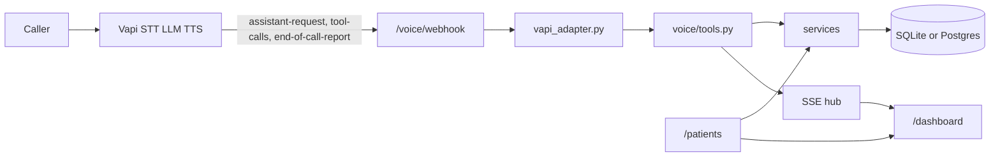

# Architecture

Telephony code stops at `app/voice/vapi_adapter.py`. It checks the shared secret, reads Vapi's `message.type`, and turns `toolCallList` into plain function calls. It does not validate a date or write a patient.

`app/voice/tools.py` is the agent's hands. It calls the same services the REST routes call. A tool result is a short JSON string Vapi can hand back to the model, including a `say` sentence.

`app/api/patients.py` parses HTTP, chooses a status code, and wraps the envelope. Field rules are not in the route.

`app/services/validation.py` is the only place a value becomes canonical or is rejected. Normalization (`normalization.py`) interprets spoken forms. The database then repeats the durable rules as `CHECK` constraints: sex, state, phone shape, ZIP shape, lengths, and required columns.

Call state that is not a patient lives in `call_sessions`, `call_events`, and `call_logs`. Relationship ("calling for my mother") and the confirmation flag live on the session. They are not columns on `patients`.

The dashboard reads `/patients`, `/calls/{id}`, and `/events`. It does not have its own database.
